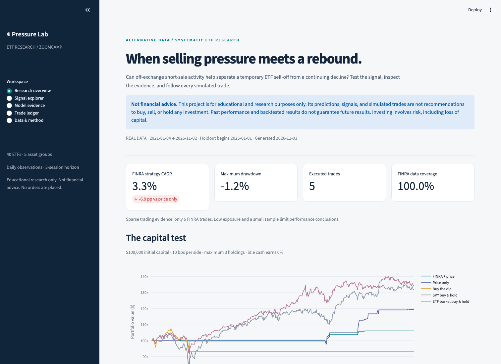

# ETF Pressure Lab

**[Open the Streamlit app](https://stock-markets-analytics-zoomcamp-project.streamlit.app/)**

**Can FINRA short-sale activity improve the decision to buy an ETF sell-off?**

> **Not financial advice.** This project is for educational and research purposes only. Its predictions, signals, and simulated trades are not recommendations to buy, sell, or hold any investment. Past performance and backtested results do not guarantee future results. Investing involves risk, including loss of capital.

A Stock Markets Analytics Zoomcamp project that tests three-session ETF rebound predictions using free price and alternative trading-activity data. It compares matched models with and without FINRA features, then asks whether the difference survives realistic capital constraints and transaction costs.

The project follows the course's data → features → ML → strategy → simulation → automation workflow. Its contribution is a specific, falsifiable research question and a controlled alternative-data comparison. It does not claim that FINRA volume reveals investor intent or outstanding short positions.



## Deploy on Streamlit Community Cloud

After the final commit is pushed, open [share.streamlit.io](https://share.streamlit.io/), create an app from this GitHub repository, select the branch containing this project, and set:

- **Main file:** `app.py`
- **Python:** `3.12` in Advanced settings
- **Secrets:** none

Click **Deploy**. The repository includes a small derived research report, so every dashboard view works on first launch without downloading market history, running training, uploading files, or configuring storage. It is clearly labeled as a published research snapshot with its observation date. Full details: [deployment guide](docs/deployment.md).

## Run locally

To view the published results locally, install the environment and launch the app; no market-data download or API key is required:

```bash
uv sync --frozen --python 3.12
uv run streamlit run app.py
```

To reproduce or update the research, use Python 3.12, [uv](https://docs.astral.sh/uv/), and internet access:

```bash
uv sync --frozen --extra dev --python 3.12
uv run etf-pressure run --mode download --start 2021-01-01 --end 2026-11-04
uv run streamlit run app.py
```

Open [localhost:8501](http://localhost:8501). The first run downloads the selected history and fits the models; allow several minutes. The end date is exclusive. To reuse the downloaded input without network requests:

```bash
uv run etf-pressure run --mode cached
```

For current data, omit `--end`. Run from the repository root. A notebook entry point is available at [notebooks/research.ipynb](notebooks/research.ipynb). Standard pip users can install `requirements.txt`, then `pip install --no-deps -e .`; uv with the lockfile is the preferred route.

## The experiment

Forty ETFs span US equity, sectors, international markets, bonds, and commodities. Prices come from Yahoo Finance through yfinance; FINRA's public consolidated daily files add short-sale activity. Both are joined into one unique ETF-day table. The [feature dictionary](docs/features.md) defines 34 price/context predictors, 14 FINRA predictors, and one asset-group categorical feature.

A sell-off is a daily loss exceeding the ETF's trailing 21-session daily volatility. Decision trees, random forests, and gradient boosting estimate whether the next three-session open-to-open return exceeds a 0.20% cost hurdle. A fixed 55% threshold selects candidates. Models tune on two expanding 2024 folds, purge labels crossing each boundary, refit using outcomes known before 2025, and test from 2025 onward.

Three strategies compete: FINRA + price, price only, and a simple buy-the-dip rule. The exact simulator tracks shares and cash, limits the portfolio to three positions and one ETF per asset group, reinvests gains, charges 10 bps each way, and blocks new entries after a 10% drawdown. SPY and a static equal-capital basket of all 40 ETFs supply capital benchmarks. Costs are stress-tested up to 50 bps per side. A vector event-return screen is reported separately from actual portfolio returns.

Read the **[measured results and failure analysis](docs/results.md)** before interpreting the charts. A weak or negative result is part of the research, not a reason to optimize against the test set.

## Explore the app

| View | Purpose | Screenshot |
|---|---|---|
| Research overview | Capital curves, benchmark, FINRA contribution, uncertainty | [Overview](docs/screenshots/overview.png) |
| Signal explorer | Latest probabilities, ETF activity, signal eligibility | [Signals](docs/screenshots/signals.png) |
| Model evidence | All six comparisons, importance, reliability, failure cases | [Models](docs/screenshots/models.png) |
| Trade ledger | Every execution and transaction-cost sensitivity | [Trades](docs/screenshots/trades.png) |
| Data & method | Coverage, observation counts, assumptions, snapshot hash | [Method](docs/screenshots/method.png) |

Screenshots are captured from the running application with real downloaded data; see [verification](docs/verification.md).

## Reproduce, automate, review

- [Research design and originality review](docs/research-design.md): hypothesis, course alignment, source checks, experiment boundaries, biases.
- [Feature dictionary](docs/features.md): definitions, units, source limitations, target timing.
- [Operations](docs/operations.md): download/cached modes, snapshots, incremental refresh, cron, Docker, optional Streamlit hosting.
- [Evaluation evidence map](docs/rubric.md): implementation evidence and deliberately unclaimed rubric items.
- [Verification](docs/verification.md): executed checks and remaining verification limits.
- [Public repository audit](docs/publication-safety.md): publication safeguards and the approved Git author-email correction.

`src/etf_pressure/` contains reusable modules; `app.py` prefers complete local research outputs and otherwise loads `reports/dashboard.json`. This report contains presentation results, not source market history, the training dataset, or executable models. GitHub Actions provides test automation and a scheduled research refresh with downloadable artifacts, including an updated dashboard report. It does not automatically change the published snapshot or commit files. Nothing is deployed automatically. The Dockerfile includes the published report and can also serve mounted local artifacts.

```bash
uv run pytest -q
uv run ruff check src tests scripts app.py
uv run etf-pressure snapshot
```

Downloaded data, snapshots, and serialized models live in ignored `data/` and `artifacts/`, following the [course deliverables rule](https://github.com/DataTalksClub/stock-markets-analytics-zoomcamp/blob/main/projects/README.md). Rebuild directly from the free sources or restore a privately supplied permitted snapshot. Derived findings and actual app screenshots are documented in Git.

## Interpretation limits

FINRA's data covers publicly reported off-exchange activity, not market-wide short interest or ETF fund flows. The fixed surviving ETF universe has selection bias. Historical file publication/revision timestamps and executable bid/ask quotes are unavailable. Adjusted opens provide a total-return-equivalent convention rather than a literal dividend-cash ledger. Cash earns no interest; taxes are excluded. Probabilities are estimates, and no broker orders are placed.

Sources: [course syllabus](https://github.com/DataTalksClub/stock-markets-analytics-zoomcamp), [FINRA data scope and terms](https://www.finra.org/finra-data/browse-catalog/short-sale-volume), [yfinance documentation and data-use notes](https://ranaroussi.github.io/yfinance/). The project uses free/open-source software; data providers retain their own usage terms.
